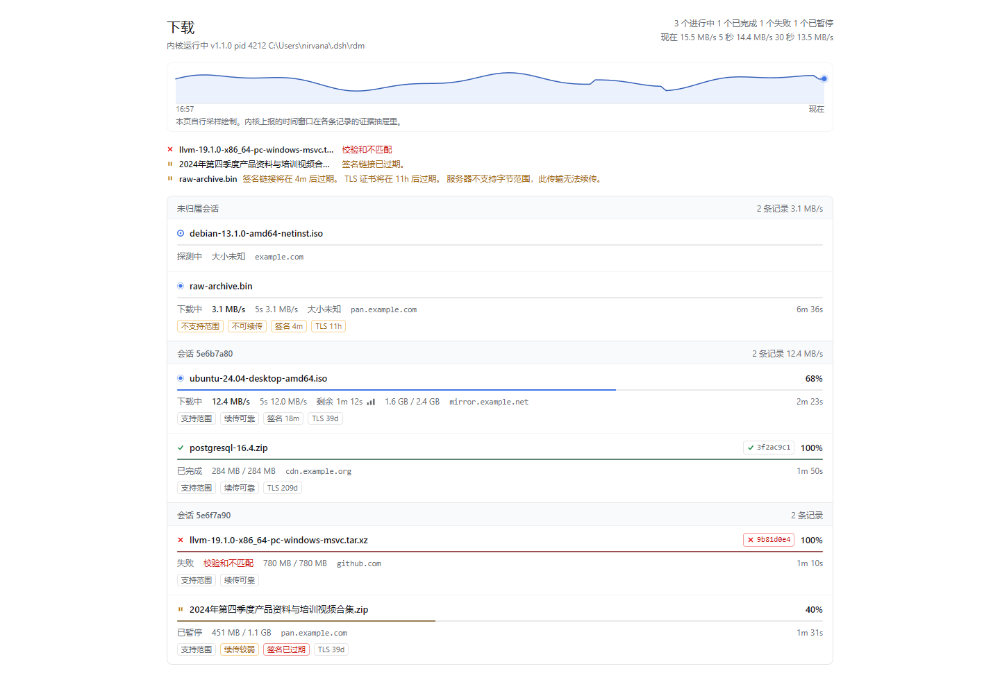
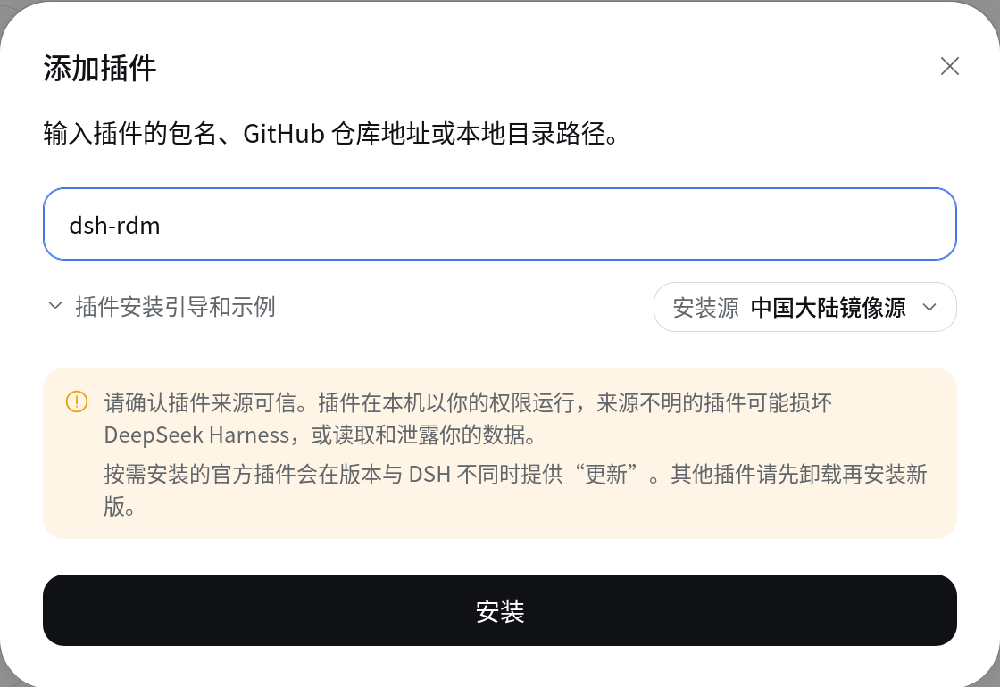
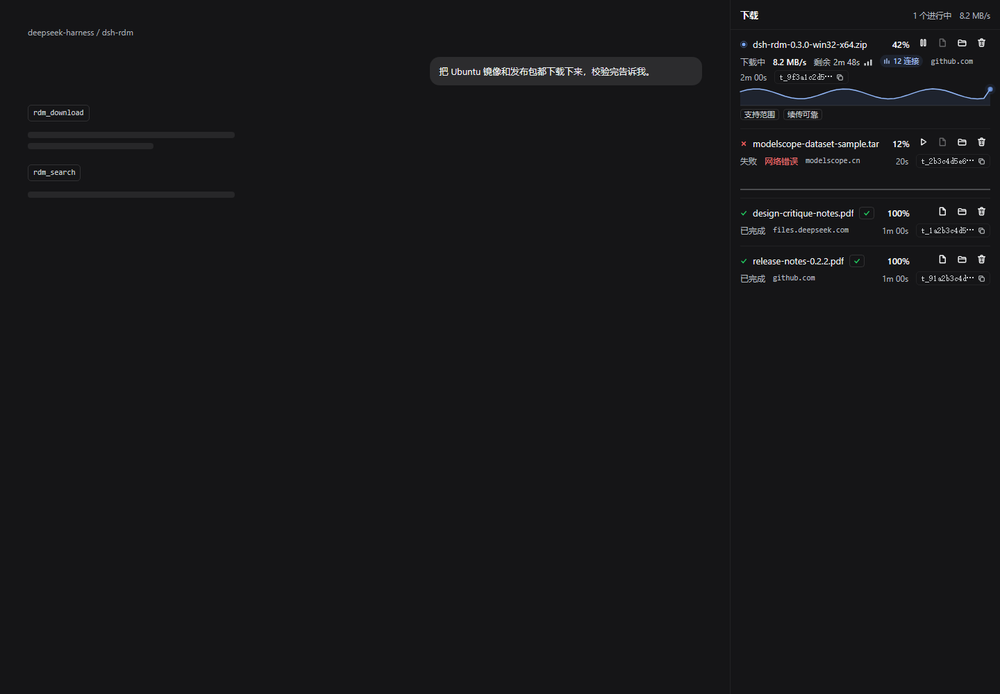
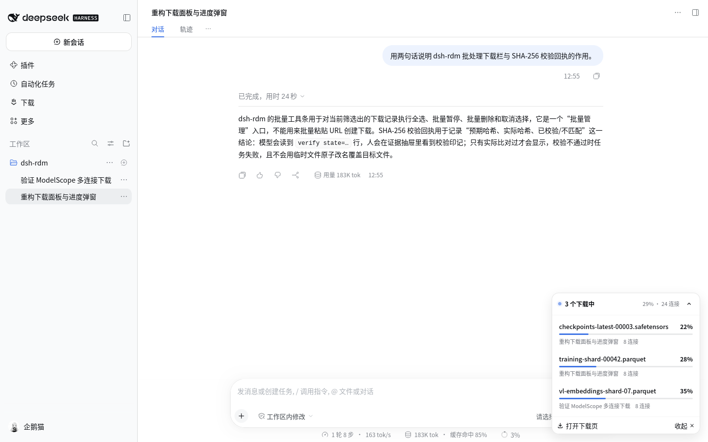
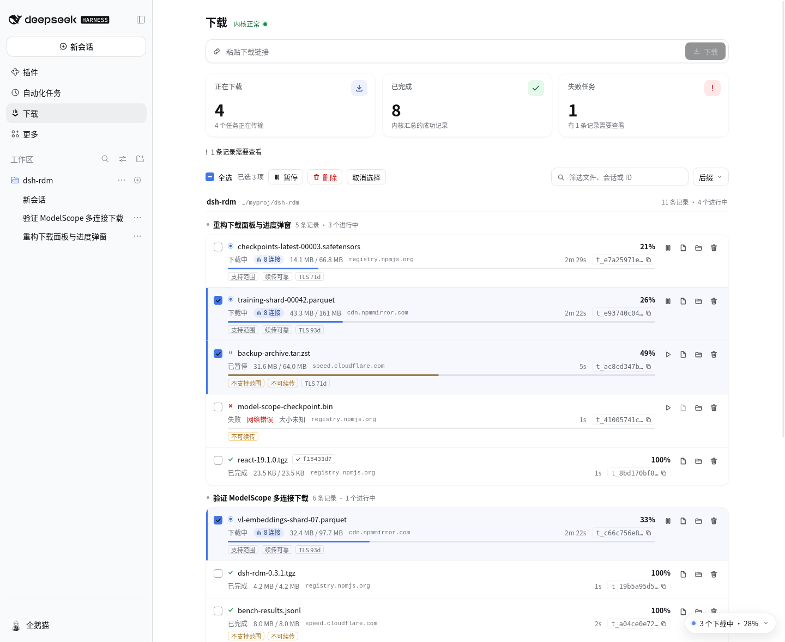

# dsh-rdm

[English](README.en.md) | [简体中文](README.md)

**面向 DeepSeek Harness 的智能体原生下载器。** 一个常驻 Rust 内核、七个面向模型且返回决策级事实的工具，以及三个面向人类的界面：左侧边栏按工作区/会话分组的下载工作台、右侧边栏的会话级审阅标签页，以及只在下载进行时出现的右上角进度弹窗。

智能体负责操作，人类负责审阅——并且可以不出面板地暂停、删除、打开与筛选。



## 安装

包内附带 Windows x64、Linux x64/arm64 与 macOS x64/arm64 的预编译内核；安装过程从不编译 Rust。

### 在 DSH 插件页安装（推荐）

本项目同步发布到 npm：打开 DSH 的插件页，点击「添加插件」，输入 `dsh-rdm` 后点「安装」即可。安装源只影响下载速度，不会改变包内容；在中国大陆可以选择「中国大陆镜像源」。



### 其他安装方式

从 GitHub 安装到某个 DSH profile：

```bash
dsh plugin --profile web add github:NIRVANA-APOC/dsh-rdm
```

从 release tarball 安装：

```bash
dsh plugin --profile web add https://github.com/NIRVANA-APOC/dsh-rdm/releases/download/<tag>/dsh-rdm-<version>.tgz
```

把本地检出作为目录 bundle 安装（DSH UI → Plugins → Install from folder，或 `plugin_manager` 工具）：

```text
plugin_manager install_bundle target=<absolute path to dsh-rdm>
```

安装后，智能体可以看到 `rdm_*`；左侧边栏出现下载工作台，右侧边栏指南新增一个“下载”标签页，整帧还会出现活跃下载弹窗（没有下载时保持隐藏）。Host 半边会随插件行重载；客户端界面需要刷新一次页面后才会出现（这个桌面版本没有暴露刷新菜单项）。浏览器路由（`POST /api/dsh-rdm/api`）的契约见 [docs/ARCHITECTURE.md](docs/ARCHITECTURE.md#browser-route-api)。

### 配置

| 键 | 默认值 | 含义 |
|---|---|---|
| `defaultDir` | `<data-dir>/downloads`（`defaultDir` 未设置时） | 未指定 `dir` 时启动的下载所用目录 |
| `connections` | `8` | 每个任务默认并行连接数（1–128）——初始 worker 规模 |
| `maxConnections` | `128` | 每个任务的权威自适应上限，收敛到 `connections..128`；控制器可在吞吐健康时越过 `connections` 增长到该值 |
| `chunkSizeMiB` | `0`（自动） | 固定分块大小；0 = 每连接四块，256 KiB–8 MiB |
| `speedLimitBps` | `0` | profile 级默认带宽上限；0 = 不限速 |
| `maxAttempts` | `6` | 每块重试预算 |
| `autoResume` | `true` | 内核启动时续传被中断的任务 |
| `dataDir` | `$DSH_HOME/dsh-rdm` | 内核数据（任务记录、来源台账、`history/` 录制） |
| `kernelPath` | 随包的 `bin/<platform>-<arch>/rdm-kernel` | 覆盖内核二进制路径 |
| `startOnDemand` | `true` | 首次使用时启动内核，而不是插件加载时启动 |
| `fsyncOnComplete` | `false` | 原子重命名前把已完成文件刷入稳定存储（fsync） |
| `logLevel` | `warn` | 内核 stderr 日志级别 |

## 实测成绩（2026-11-10）

在 Windows 11 / Ryzen 7 9700X 上，用 4 个 HTTP(S) 任务对比 aria2 1.37.0 与 Gopeed 1.9.3：3.3 MiB 小文件、61 MiB ISO、986 MiB ISO，以及 38.5 MiB GitHub 302/签名重定向。共 **62 次下载、20.65 GiB**，所有文件 SHA-256 校验通过（实测版本 `0.3.0-alpha.2`，与 0.3.0 运行时行为一致）。

| 场景 | dsh-rdm | aria2 | Gopeed | 结果 |
|---|---:|---:|---:|---|
| 3.3 MiB 小文件 | **0.138 s** | 0.247 s | 0.202 s | 比 aria2 快 **44.1%** |
| 61 MiB ISO | **0.719 s** | 0.865 s | 0.851 s | 比 aria2 快 **16.9%** |
| 986 MiB ISO | **9.272 s**（自适应） | 9.608 s | 10.826 s | 自适应快 **3.5%**；固定 16 连接 9.526 s |
| 38.5 MiB GitHub 重定向 | 7.311 s | **7.085 s** | 7.480 s | 比 aria2 慢 3.2%，此场景 aria2 最优 |

同一批 986 MiB 任务中，dsh-rdm 自适应的 CPU 为 6.06 s、峰值内存 37.5 MB；aria2 为 6.88 s / 29.2 MB，Gopeed 为 8.38 s / 53.1 MB。dsh-rdm 在小文件、中文件和稳定大镜像上领先；GitHub 慢链路上 aria2 更稳。

完整方法、逐次数据与复现脚本见 [session_logs/20261110-downloader-bench/README.md](session_logs/20261110-downloader-bench/README.md)。

## “智能体原生”在这里的含义

被模型使用的下载器，不是“恰好带 API 的 GUI”。智能体必须用尽可能少的模型步数回答：*这个 URL 是否可用、应该怎么取、现在发生了什么、是否需要干预、结果是否可信？* `dsh-rdm` 0.3.0 就是围绕这些问题构建的。

* **决策级探测。** `rdm_probe` 返回完整的服务器事实记录——经证实的字节范围支持、校验器与 RFC 9110 续传安全性、签名链接过期、TLS 证书有效期、重定向链、校验和可用性、速率限制响应头、耗时、稳定的警告码，以及具体建议。而不是一句“200 OK，48 MB”。
* **启动时预检。** `rdm_download` 会把同一份服务器事实附着到任务上（有界等待，默认 2 秒），这样智能体无需第二次调用就能决定暂停、校验还是继续等待。
* **诚实的实时遥测。** 四个实测吞吐窗口（1 s / 5 s / 30 s / 300 s）、峰值、平均、停滞时长、趋势，以及一个在数据不足时会降级为 `unknown` 的 `etaConfidence`，而不是伪造精度。
* **可以超过请求值的自适应并发。** 任务以请求的连接数起步，但控制器可以在聚合吞吐仍有空间时把 worker 目标增长到 `maxConnections`（默认 128），在增长稀释吞吐时回退，在饱和的平台期停止增长，并在传输中途吞吐塌陷时重建连接池。`connections` 始终是初始并发规模，`requestedConnections` 保留调用方请求值；尾部排空期间目标冻结，最后几个 chunk 不会被误判为“吞吐下降”。
* **能跨易变 URL 存活的续传。** 续传状态按稳定身份（URL 路径、大小、校验器）匹配，而不是按签名最终 URL 上按请求变化的 `auth_key` / `Expires` / `Policy` 令牌匹配——重新探测不会再丢掉已完成的字节。每次尝试都会报告 `resumeDecision` / `resumeReason`。
* **多源调度。** `rdm_download` 可为同一对象传最多 8 个 HTTP(S) 候选源与策略：`select` 并发探测后选实测最快，`failover` 失败切换，`hedge` 用前两个源对冲首段，`race` 在每源连接上限内把分块分给池中源。只有共享强内容身份（`expectedSha256`、服务器 SHA-256/Content-Digest，或相同大小 + 强 ETag）才允许混用字节，错误镜像会被拒绝而不是静默拼接。自动解析 Metalink/HTTP `Link: rel=duplicate` 与 `.meta4` 文档；任务视图/详情展示选中源、备选、切换次数与每源字节/速率。
* **记录下来的下载数据。** 任务运行期间，逐样本遥测与事件以 JSONL 追加到 `<dataDir>/history/`；`rdm_history` 可在事后或内核重启后按有界窗口读回，因此传输可以回放、内核可以调参，而不必手工采样。
* **带构建归属的记录。** 每次运行先写一条 meta 记录——内核版本、pid、run、文件/总量/分块、请求/初始/上限 worker 数、续传决策——这样跨内核构建（传输中途重启）的录制仍能说明每段序列由哪个构建产生。`rdm_history` 以 build 标签呈现，而不是悄悄混合序列。
* **续传后速率从零开始。** `transferredBytes` 以及所有速度/峰值/ETA 计算都使用本次运行的字节数；`avgBps` 则是整文件进度除以持久化的累计耗时，续传任务不会再报出从已接续 `.part` 字节继承来的多 GiB/s 速率或峰值。
* **长轮询，而非高频轮询。** `rdm_wait` 阻塞到任务全部进入终态或超时，并返回类型化的 `timedOut`；状态结果扁平且有界。
* **结构化回执、有界的规范 JSON。** 模型读取字段顺序稳定的行式 `key=value` 回执；程序调用方拿到规范 JSON。可恢复失败是值（`error code=…` 加 `next …`），而不是会丢失结构的抛出字符串。
* **会话归属。** 智能体发起的每个下载都携带其所属的会话 id，因此人类可以精确审阅*这个*智能体下载了什么。
* **会话归属说人话。** 每个下载都保留所属会话 id，工作台再从会话日志与持久化工作区注册表解析出真实标题与工作区，所以记录会出现在「重构下载面板与进度弹窗 · dsh-rdm」下面，而不是一串看不懂的 id。
* **记录可被检索。** `rdm_search` 支持跨会话按关键字（文件名、URL、主机、路径、id、会话标题）或精确任务 id 查找已有下载；每条记录也向人类提供可复制的下载 id。
* **一条策略，只声明一次。** 一段简短的系统提示词段告诉每个智能体把下载交给 `rdm_*`；工具定义保持精简（0.2.0 把首轮 schema 成本从 7241 降到 4966 字符，比 0.1.2 减少 31%；回执测试把七工具表面守在 7241 字符以内，实测 6909）。

## 三个界面

* **下载工作台**（左侧边栏入口 → 页面）：粘贴链接即可开始下载；三张状态卡片（正在下载 / 已完成 / 失败任务）同时充当状态筛选；文本筛选 + 后缀多选下拉；全选与批量暂停/删除；记录按工作区分大组、再按真实会话标题分小组。每条记录展示进度、速度、剩余时间、当前自适应连接数、主机、用时与可复制的下载 id，并提供暂停/继续/打开文件/打开所在目录/删除与证据抽屉（请求链、服务器事实、耗时、worker 计划、续传状态、校验、有界事件日志）。
* **会话审阅**（右侧边栏标签页“下载”）：同一套记录语言与操作，只筛选当前会话；没有输入框与批量工具条。
* **活跃下载弹窗**（右上角、跨面板）：每个有进行中任务的会话一行——进度、速度与连接数汇总——可展开或收成胶囊。没有下载在进行时它不存在。
* **证据语言**：一条**吞吐脉冲**（客户端采样、如实标注）和一个**校验印记**（预期与实际哈希，仅在确实比较过哈希时出现）。未知值渲染为 `—`。





批量选择与工具条：



## 工具

七个工具。所有输出都有界；模型看到回执，调用方看到规范 JSON。

| 工具 | 作用 | 返回 |
|---|---|---|
| `rdm_probe` | 检查 HTTP(S) 源而不下载文件本体 | `ServerFacts`：字节范围、校验器、续传安全性、签名链接/TLS 过期、重定向、校验和、速率限制、耗时、警告、建议 |
| `rdm_download` | 在常驻内核中启动传输；可选 `sources[]` 镜像、`sourcePolicy`（`single`/`select`/`failover`/`hedge`/`race`）、`sourceRaceBytes`、`discoverSources`、`metalinkFile` | 任务视图（含选中源/备选）+ 预检 `ServerFacts`（≤2 s）+ 下一步提示；`waitSec` 可选阻塞 |
| `rdm_tasks` | 列出本会话的下载，或深入查看单个下载 | 扁平任务视图 + 聚合；带 `taskId` 时返回遥测、服务器事实、校验、诊断、有界事件 |
| `rdm_search` | 跨会话按关键字（id、文件名、URL、主机、路径、会话标题）或精确 id 查找记录 | 有界匹配结果（id、状态、进度、会话/工作区标签）+ 总数；支持 `scope`、状态与条数筛选 |
| `rdm_history` | 读取持久化的单任务记录（逐样本遥测 + 事件 + 每次运行的构建/计划 meta，位于内核数据目录下的 JSONL） | 有界的样本/事件 + `samplesPath`/`eventsPath` + 总数；带 meta 时给出 `builds` 标签（以及一行 `build=` 回执）；默认返回均匀降采样的审阅序列，传 `offset` 则按字面翻页；跨内核重启保留 |
| `rdm_wait` | 长轮询直到终态或超时 | 已结算的任务视图 + `timedOut` |
| `rdm_control` | 暂停、继续、取消、重试、移除 | 更新后的任务视图（或已移除的 id） |

一次检索回执：

```text
search scope=all matches=2 total=14
task t_9f3a1c2d5e6b7a80 state=running progress=42% session="重构下载面板与进度弹窗" workspace="dsh-rdm" file="dsh-rdm-0.3.0-win32-x64.zip" connections=12/16
task t_1a2b3c4d5e6f7a80 state=completed progress=100% session="重构下载面板与进度弹窗" workspace="dsh-rdm" file="design-critique-notes.pdf" connections=0/0
```

一次探测回执：

```text
probe host=cdn.example.com status=200 http=HTTP/2.0
url https://cdn.example.com/app.zip?sig=<redacted>
file name=app.zip source=content-disposition size=48.1MiB type=application/zip encoding=-
range=bytes resume=strong signed=valid(19m40s) tls=valid(40d) checksum=none
plan start=now connections=8 chunk=1.5MiB singleStream=false verify=recommended reason=ranges+strong-etag
headers server=nginx cache=max-age=3600 vary=Accept-Encoding
warnings=- redirects=0
timing probe=84ms ttfb=61ms sample=- origin=known attempts=3 completed=2 median=14MiB/s best=22MiB/s lastError=-
next rdm_download url=https://cdn.example.com/app.zip?sig=<redacted>
```

一次任务列表回执：

```text
kernel state=running version=0.3.0 pid=4212
scope=session count=1
aggregate total=3 active=1 paused=0 failed=1 completed=1 bytes=2.5GiB now=12.4MiB/s w5=12MiB/s w30=11.5MiB/s w300=- risk=0
t_9f3a1c2d5e6b7a80 running 68% 1.6/2.4GiB 12.4MiB/s w5=12.0MiB/s eta=1m12s(high) workers=8/8 range=bytes resume=strong name=ubuntu-24.04.iso
```

一次录制历史回执：

```text
history task=t_9f3a1c2d5e6b7a80 samples=1907 peak=70.4MiB/s avg=20.9MiB/s
samples <dataDir>/history/t_9f3a1c2d5e6b7a80.samples.jsonl
events <dataDir>/history/t_9f3a1c2d5e6b7a80.events.jsonl
range 0..300 of 1907
```

## 内核智能

Rust 内核（`rdm-kernel` 0.3.0，协议 2）是一个常驻子进程：不监听端口，惰性启动并保持常驻。

* **服务器事实** —— 手动跟随的重定向链（最多 8 跳）、经证实的字节范围支持（带已验证 `Content-Range` 的 206，而不是只看 `Accept-Ranges` 响应头）、按 RFC 9110 对校验器做强/弱分类、从最终 URL 推导的各类签名链接过期时间（AWS SigV4/SigV2、GCS SigV4、Azure SAS、通用 `Expires`、ModelScope `auth_key`）、TLS 叶子证书 `notAfter`、校验和可用性（`Content-Digest`/`Content-MD5`/S3 SHA-256/CRC32C）、`Retry-After`、探测/TTFB 耗时，以及有界警告码。携带凭据的值（含 `auth_key` 与每个重定向跳点）在所有投影中都会脱敏。
* **保持诚实的续传** —— `.part` + 续传状态、校验器兼容性检查，以及显式的 `resumeSafety`：`strong`/`weak`/`none`。内核只为强 ETag 发送 `If-Range`；弱校验器续传会重新探测并校验 `Content-Range`/长度，若源站忽略字节范围则回退为完整响应体。兼容性按稳定身份（URL 路径、大小、校验器）判定，最终 URL 上按请求变化的 `auth_key`/`Expires`/`Policy` 令牌不会再让已完成的分块表作废；每次尝试都会报告 `resumeDecision`/`resumeReason`。进行中的下载在签名链接过期后仍会继续；过期后再续传则不会——诊断会给出“不要暂停”。
* **实测遥测** —— 以 100 ms 节奏采样的有界 3000 样本环驱动四个窗口、峰值/平均、停滞和趋势，不额外增加定时器。续传后所有窗口与峰值都从本次运行的基线（`transferredBytes`）开始；`avgBps` 使用整文件进度除以持久化累计耗时，绝不把已接续的字节当作速率。
* **不仅实测，而且落盘记录** —— 任务运行期间，每个采样与任务事件都以 JSONL 追加到 `<data-dir>/history/` 下（每个任务 ≤10 万个样本；写前脱敏；写入失败只作提示，绝不影响或拖慢下载）。每次运行先追加一条 meta 记录（内核版本、pid、run、计划/续传状态），因此跨内核重启或构建变化的录制仍保有归属；`rdm_history` 读回并展示 build 标签。
* **来源台账** —— 有界 256 台主机的记忆：尝试/完成/中位/最佳吞吐/最近错误，由 `rdm_probe`（`origin=…`）和 `stats` 报告。
* **分段传输** —— 每个任务 1–128 条连接，外加自适应上限（`maxConnections`，默认 128）：控制器按聚合吞吐增长、在聚合下降时回退、在饱和时冻结、在尾部排空时保持目标、在服务端推回时退避，并在吞吐塌陷时重建连接池；同时带尾部窃取的动态分块队列，指数退避重试，每任务带宽上限，以及原子重命名前可选的 SHA-256 校验。
* **感知尾部的收尾** —— 当剩余 chunk 数不多于 worker 目标时，claim 使用 3 秒停滞期限与快速重试（250 ms × 尝试次数，封顶 1 秒），而不是在一条失效的长尾连接上等 10 秒。
* **有界** —— 每个任务在视图环中 ≤200 条事件、内存中 ≤3000 个遥测样本、落盘 ≤10 万个样本/任务、每次响应 ≤20 条构建/计划 meta、≤256 个来源，不缓冲完整响应体，stdout 专供协议使用。

性能工作与测量见 [docs/OPTIMIZATION.md](docs/OPTIMIZATION.md)；架构与协议见 [docs/ARCHITECTURE.md](docs/ARCHITECTURE.md) 和 [PROTOCOL.md](PROTOCOL.md)。0.2.0 的设计推理见 [docs/design/0.2.0-agent-native.md](docs/design/0.2.0-agent-native.md)；0.2.1 的真实数据证据与修复见 [docs/design/0.2.1-real-data-fixes.md](docs/design/0.2.1-real-data-fixes.md)；0.2.2 的 ModelScope 实测与控制器/尾部/计量改动见 [docs/design/0.2.2-live-modelscope-pass.md](docs/design/0.2.2-live-modelscope-pass.md)，证据笔记见 [docs/research/agent-native-downloader.md](docs/research/agent-native-downloader.md)；版本记录见 [CHANGELOG.md](CHANGELOG.md)（每个 tag 一节，版本号与 changelog 必须同一次改动一起更新）。从 0.2.2 起，内核与插件包共用同一版本号（当前 `0.3.0`，协议 2）；0.3.0 正式版合并工作台/搜索与多源调度。历史录制保留二进制实际写入的版本串（0.2.1 内核 = `1.1.0`，版本统一前的 0.2.2 构建 = `1.2.0`）。

## 验证

* `node scripts/verify-kernel.mjs` —— 针对本地 fixture 的内核 e2e（这是规范套件；它会启动内核，因此需要允许创建子进程的宿主）。
* `python tests/verify_e2e.py` —— 进程外协议 2 驱动，用于 Node 无法创建子进程的宿主（见下文）：探测事实、签名链接、重定向、会话范围、遥测、暂停/继续（含跨易变令牌最终 URL 的续传）、`maxConnections` 收敛、带每次运行构建 meta 的录制历史、`transferredBytes`/`requestedConnections`、plan/回执消息形状、`unsupported_method`、`auth_key` 脱敏、统计、聚合。
* `node tests/tools-receipts.test.mjs` —— 回执契约、策略只声明一次、schema 成本守卫、可恢复错误回执。
* `node tests/host-api.test.mjs` —— 浏览器路由 v3 契约：会话/工作区补全与降级、批量 control 的逐项结果、活跃 Agent 通知门控、移除前快照、`open` 的路径解析/拒绝、catalog 缓存/单飞，以及 `apply()` 装配冒烟测试。
* `node node_modules/typescript/bin/tsc --noEmit` —— 宿主与客户端源码的严格 TypeScript 检查。
* `node scripts/verify-fixture.mjs` —— fixture 自测。
* `node scripts/verify-kernels.mjs --host --run` —— 当前宿主的随包内核存在、格式正确且能启动。

本版本实测的 QA 报告见 [docs/verification.md](docs/verification.md)。

## 安全与隐私

* 携带凭据的查询参数值会在**规范层脱敏**，而不只是在 UI 里：`ServerFacts`/任务视图会把 `X-Amz-Signature`、`Signature`、`sig`、`token`、`auth_key`、访问密钥及类似的值替换为 `<redacted>`——最终 URL 与每个重定向跳点都如此。请求头和 cookie 从不出现在任何协议视图、回执或 UI 中。
* 磁盘上的任务记录可能保留请求凭据，以便内核重启后续传时能够认证。它们只存放在内核数据目录下；请将该目录视为所有者敏感（owner-sensitive）。
* 浏览器路由由 Harness 的 connection 服务认证；内核不开放任何网络监听，只通过 stdio 使用 NDJSON。
* `insecure: true` 会为单个任务禁用 TLS 验证（仅限调试）；探测仍会报告它能读取到的证书事实。

## 限制（如实说明）

* **镜像/多源：** 已实现为**同一对象的 HTTP(S) 候选源**（`sources[]`，最多 8 个）。跨协议源（FTP/S3/torrent）、自动抓取公网镜像、多文件/前缀结果仍不在范围内。`race`/`failover` 只有在所有源共享强内容身份时才混用字节；`select`/`hedge` 提交到单一源。
* `maxConnections: 128` 是安全上限，不是“128 路并发”的承诺：实际并发由控制器决定，并从 `connections` 起步。
* 远端变化导致的续传问题通过校验器发现；只有弱校验器的源站仍可能返回在同一秒内发生变化过的字节——此时 `weak` 安全性标签就是如实的信号。被拒绝的续传会说明原因（`resumeDecision`/`resumeReason`），而不是静默清零重来。
* JSONL 录制是诊断数据，不是持久化契约：它有界、尽力而为，录制失败绝不影响下载。0.2.1 之前开始的录制没有样本，0.2.1 时代的文件没有构建 meta——工具如实报告存在的数据，而不是编造序列。
* 传输后的 SHA-256 校验仍然是串行执行（乱序 chunk 无法流式汇入同一个哈希；引入 chunk 哈希树会改变校验契约）。在多 GiB 文件上它会占几个百分点的墙钟时间。
* 控制器的增长/饱和决策只是基于实测窗口的启发式判断；它们只调整 worker 目标，从不改变任务状态或正确性。
* ETA 置信度是对实测窗口的启发式判断；数据不足时它是 `unknown`，而不是猜出来的数字。
* 工作台的输入框只按插件默认配置启动下载；连接数、请求头与校验和仍是智能体侧 `rdm_download` 的参数，不是输入框字段。
* 从 UI 暂停或删除未结束的下载时，只有对应的 Agent 仍活跃才会收到通知；冷会话不会因为一次 UI 点击而被唤醒，结果显示 `notified=false`。
* 打开文件/所在目录交给宿主桌面的默认处理程序（`explorer`、`open`、`xdg-open`），且要求任务记录仍然存在；它不内嵌文件查看器。
* 工作区与会话标题来自宿主的 workspace registry 与会话日志；缺少这些服务的部署仍会渲染台账，只是按短会话 id 分组。
* 活跃下载弹窗是跨面板的，会在下载进行时覆盖右上角；如果挡住控件，可以收成胶囊。
* 五个平台的预编译内核由 release 工作流在原生 runner 上构建；在工作流刷新 `bin/` 之前，本地检出只包含当前宿主最新构建的内核。
* 沙箱化的智能体宿主可能拒绝 Node 创建子进程；这种环境下请用 `bash scripts/dev-build.sh` 构建，用 `python tests/verify_e2e.py` 运行内核套件（两者都记录在 [docs/ARCHITECTURE.md](docs/ARCHITECTURE.md)）。

## 开发

```bash
npm install
bash scripts/dev-build.sh all      # 宿主 + 客户端，沙箱安全
bash scripts/dev-build.sh kernel   # cargo release 构建并安装到 bin/
node scripts/build.mjs             # 沙箱外的规范构建
node scripts/build-kernel.mjs      # 沙箱外的规范内核构建
python tests/verify_e2e.py         # 协议 2 内核套件（沙箱安全）
node tests/tools-receipts.test.mjs # 宿主回执契约
node tests/host-api.test.mjs       # 浏览器路由 v3 契约
node scripts/check-release.mjs     # package/kernel/changelog 一致性
```

浏览器界面有一份确定性的静态预览工具，位于 `.design/preview-03/`（不随包发布）：它用真实组件对接 mock 的 v3 路由，产出浅/深色 1440/768/390 截图矩阵，并可通过无头 Chrome 的 CDP 端点抓图；两条抓图路径见 `capture.ps1` / `cdp.mjs` 文件头。

发布流程——五平台内核矩阵、GitHub release、npm trusted publishing 与重试语义——记录在 [docs/release.md](docs/release.md)。

宿主半边只导入 Node 内置模块（schema 库以 vendor 方式内置）；客户端半边注册到 `sidebar.panellist`、带 key 的 `main` 槽位、跨帧的 `shell.overlay` 座位和原生右侧边栏标签座位，并且只使用宿主主题 token。客户端自包含：工作台与弹窗共享同一份浏览器路由轮询，会话标签页只轮询自己的作用域。

## 许可

MIT OR Apache-2.0。


