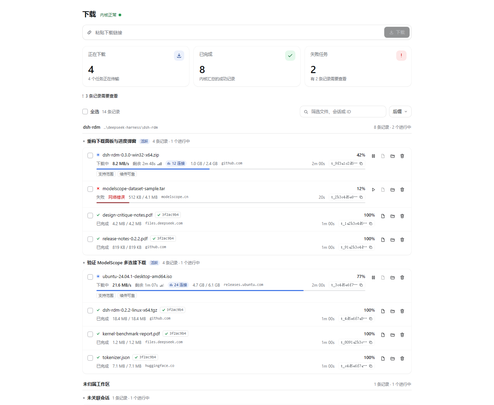
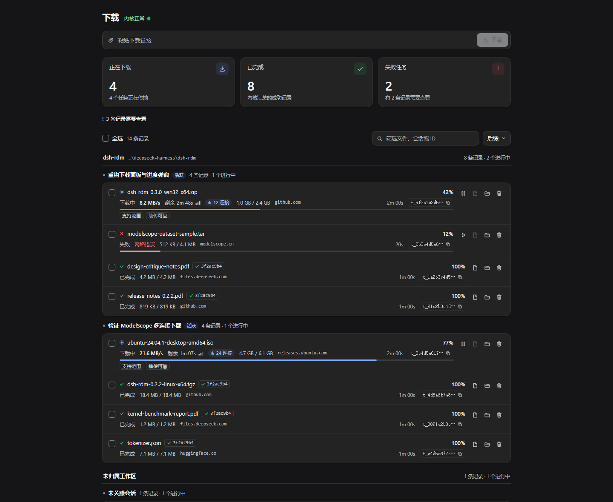

# dsh-rdm

[English](README.md) | [简体中文](README.zh-CN.md)

面向 **DeepSeek Harness** 的常驻多连接下载引擎。

`dsh-rdm` 在五个面向模型的工具和一个侧边栏下载面板背后，维持一个长期驻留的
Rust `rdm-kernel` 进程。下载支持分段、断点续传、校验与限速，并且能跨暂停、崩溃、
内核重启和 DSH 重启继续——不需要为每个文件启动一个进程，也不需要让 agent 去
shell 调用 `curl`。



## 特性

* **常驻内核，惰性启动** —— 每个 DSH 宿主一个 `rdm-kernel` 子进程，在首次使用
  工具/面板时启动并保持常驻。stdio 上跑 NDJSON，不监听端口。空闲时常驻内存约
  5.7–6.7 MiB。
* **分段多连接传输** —— 每个任务 1–32 条连接，动态分块队列支持运行中尾部窃取，
  AIMD 并发控制器会对 429/503 回退。没有 `Content-Length` 的传输会读到 EOF。
* **天生可续传** —— 每约 500 ms 将暂停状态持久化为 `<target>.part` +
  `<target>.part.json`，因此暂停、被杀或中断的传输在内核或 DSH 重启后能按自己的
  字节区间继续。校验器（ETag、Last-Modified、总大小）能发现暂停期间远端文件已变化，
  避免把新旧字节拼在一起。
* **完整性** —— 可选的 SHA-256 会在 `.part` 原子重命名为最终文件之前校验；不匹配
  时任务失败，目标路径保持不变。
* **带宽控制** —— 每个任务可用 `speedLimitBps` 限速，也可配置全局默认值。
* **只探测不下载** —— `rdm_probe` 通过 HEAD（必要时回退到 range GET）返回最终
  URL、文件名、大小、是否支持 range、内容类型和校验器。
* **Agent 优先的工具** —— `rdm_download`、`rdm_probe`、`rdm_tasks`、`rdm_wait`
  和 `rdm_control`，外加一段系统提示词，告诉每个 agent 把文件下载都走这些工具。
* **侧边栏面板** —— 左侧边栏的下载图标打开传输台账：实时状态、百分比、速度、
  ETA、每任务的连接通道仪表、过滤器、行内暂停/继续/重试/取消/移除/复制路径、
  带内核事件日志的内联详情，以及新建下载的启动栏。
* **有界且本地** —— 每个响应都是有界、结构稳定的 JSON；任务事件有上限；内核从不
  缓冲完整响应体。浏览器侧通过带认证的 `POST /api/dsh-rdm/api` 路由与宿主通信。
* **宿主侧自包含** —— 宿主 bundle 只导入 Node 内置模块；需要的 schema 库以
  vendor 方式（MIT）打入产物。
* **预编译内核，安装时不编译** —— `bin/<platform>-<arch>/rdm-kernel[.exe]` 随包
  提供 Windows x64、Linux x64/arm64 和 macOS x64/arm64 版本，全部在原生 CI runner
  上构建。安装插件从不会运行 cargo；常驻内核从随包二进制惰性启动
  （见[预编译内核](#预编译内核)）。

## 工具

所有工具都返回有界、结构稳定的 JSON。长时间下载在后台运行，用 `rdm_wait` /
`rdm_tasks` 监控。

| 工具 | 用途 |
|---|---|
| `rdm_download` | 开始下载（`url`、`dir`、`fileName`、`connections`、`headers`、`cookie`、`referer`、`userAgent`、`expectedSha256`、`speedLimitBps`、`resume`、`singleStream`、`proxy`、`insecure`）。立即返回任务；`waitSec` 可选等待最多 300 s。 |
| `rdm_probe` | 只取元数据：最终 URL、文件名、总大小、range 支持、内容类型。 |
| `rdm_tasks` | 内核状态 + 任务列表（可按状态过滤），或单个任务的详情与最近内核事件。 |
| `rdm_wait` | 等待最多 20 个任务 id 进入终态（超时 ≤ 300 s）。 |
| `rdm_control` | 对任务执行 `pause` / `resume` / `cancel` / `retry` / `remove`。 |

Agent 调用示例：

```text
rdm_download { url: "https://example.com/img.iso", dir: "C:\\Downloads\\iso", expectedSha256: "…" }
→ { id: "t_9f3a…", status: "running", … }
rdm_wait     { taskIds: ["t_9f3a…"], timeoutSec: 120 }
→ { tasks: [{ status: "completed", path: "C:\\Downloads\\iso\\img.iso", sha256: "…" }], timedOut: false }
```

## 安装

直接从 GitHub 装进某个 profile：

```powershell
dsh plugin --profile web add github:NIRVANA-APOC/dsh-rdm
```

或安装已发布的 npm 包：

```powershell
dsh plugin --profile web add dsh-rdm
```

或在 DSH 会话里把本地检出作为目录 bundle 安装：

```text
plugin_manager install_bundle target=<dsh-rdm 的绝对路径>
```

首次安装后刷新 Web 页面。插件行由 `cordis.patch.yml` 插入；内核二进制从包内的
`bin/<platform>-<arch>/rdm-kernel[.exe]` 解析。

npm 安装、GitHub 安装或 release tarball 安装都不需要构建步骤：包里已经带有构建好的
`lib/` bundle 以及所有支持平台的预编译内核（见[预编译内核](#预编译内核)）。GitHub
release 还会发布完整的插件 tarball，这是最可复现的安装方式：

```powershell
dsh plugin --profile web add https://github.com/NIRVANA-APOC/dsh-rdm/releases/download/<tag>/dsh-rdm-<version>.tgz
```

## 预编译内核

`rdm-kernel` 是 Rust 二进制，但它在打包**之前**、在具备对应工具链的机器上编译，
从不在安装插件的宿主上编译。`package.json` 里没有 `prepare`/`install`/`postinstall`
钩子；宿主在运行时解析随包文件，并在首次使用时惰性启动。

| 目标目录 | 平台 | 构建环境 |
|---|---|---|
| `bin/linux-x64/rdm-kernel` | Linux x64 | `ubuntu-24.04` |
| `bin/linux-arm64/rdm-kernel` | Linux arm64 | `ubuntu-24.04-arm` |
| `bin/win32-x64/rdm-kernel.exe` | Windows x64 | `windows-latest` |
| `bin/darwin-x64/rdm-kernel` | macOS x64 | `macos-15-intel` |
| `bin/darwin-arm64/rdm-kernel` | macOS arm64 | `macos-15` |

[`.github/workflows/prebuilt-kernels.yml`](.github/workflows/prebuilt-kernels.yml)
在原生 runner 上构建全部五个目标，并在每个 runner 上运行
`node scripts/verify-kernels.mjs --host --run`。两个任务消费这些产物：

* **`v*` 标签** —— 用 `lib/` 加全部五个 bin 目录打包 `dsh-rdm-<version>.tgz`，
  连同各平台内核和一份 `sha256` 清单一起附到 GitHub release。上面的 release 安装
  命令使用的就是该 tarball。
* **手动运行（`workflow_dispatch`）** —— 构建后默认把刷新过的内核提交回默认分支的
  `bin/`，这样直接用 `github:…` 安装也能跨平台。取消勾选 `commit_binaries` 则只
  产出 artifact。该任务要求仓库的 workflow token 具备写权限
  （Settings → Actions → General → Workflow permissions），分支保护也要允许 bot
  推送到默认分支。

本地检查（无需网络；二进制已存在时也无需 Rust）：

```bash
node scripts/verify-kernels.mjs            # 全部五个目标：格式 magic + 可执行位 + sha256
node scripts/verify-kernels.mjs --host --run   # 仅当前宿主，并实际启动一次
```

同一个脚本也在打包任务里运行，因此缺失或标错平台的内核不可能随 release 发布。
release 资产里还带有 `rdm-kernels.sha256` 文件。

## 界面

下载器位于**左侧边栏入口**（`sidebar.panellist`，id 为 `rdm`，order 30）；选中它
会打开对应的**主面板**（`main`，key 为 `rdm`）。面板是一张传输台账，而不是表单
加卡片的组合：

* 头部：页面标题和一行纯引擎状态（版本与 pid 在 tooltip 里），没有刷新按钮——
  页面每秒轮询一次，文档隐藏时暂停；
* 启动栏：一个 URL 输入框加一个主 Start 按钮。目录和连接数收在
  **选项 / Options** 后面；回车即开始，非法输入就地说明，成功启动后焦点回到输入框；
* 所有下载共用一张台账：状态点与状态词、文件名、百分比和一条细字节轨。未知长度
  传输用扫动表示，而不是伪造百分比；暂停、完成和失败会改变轨道颜色并停止动画；
* 每行 meta 行里的**连接通道仪表**：每条计划连接一个刻度，已就位的连接点亮，且
  只有传输进行中时它们才呼吸；
* 按状态显示的遥测——大小、速度、ETA 和连接使用情况只在有意义时出现；完成行显示
  保存路径和复制操作；失败行显示内核错误；
* 过滤器（全部 / 未完成 / 历史）带计数，另有运行数、总速度和失败数的实时汇总；
* 每行图标操作：暂停/继续/重试/复制路径、详情，以及一个更多操作菜单（取消下载、
  从列表移除、复制链接）。宽度 ≤520 px 时图标操作折进该菜单，给文件名留出空间。
  行级错误通过 `role="alert"` 播报；
* 内联详情：源 URL 与最终 URL、保存路径、分块大小、已续传块数、SHA-256 校验、
  计时、重试次数，以及有界的内核事件日志；
* 复制操作会弹一个短 toast；中英文文案都来自 `locale/*.json`。



样式只使用宿主主题 token（`--dsw-alias-*`、`--dsw-specific-*`、`--ds-*`），因此
浅色/深色模式、字体和圆角都来自宿主。通道轨是面板唯一的动画元素；
`prefers-reduced-motion` 会关闭它以及骨架、菜单、详情的动效；每个控件都有可见的
焦点环。

## 配置

在插件行的 `config` 里设置字段（profile patch 层或插件设置）；默认值见
`cordis.patch.yml`。

| 键 | 默认值 | 含义 |
|---|---|---|
| `defaultDir` | `""` | 默认下载目录；空 = `<当前 dataDir>/downloads` |
| `connections` | `8` | 每任务连接数上限（1–32） |
| `chunkSizeMiB` | `0` | 固定请求分块大小（0.25–64 MiB）；`0` = 自动（每连接 4 块，0.25–8 MiB） |
| `speedLimitBps` | `0` | 默认每任务带宽上限（0 = 不限） |
| `maxAttempts` | `6` | 每块重试预算 |
| `autoResume` | `true` | 内核重启后自动续传被中断的任务 |
| `dataDir` | `""` | 内核数据目录（默认 `$DSH_HOME/dsh-rdm`，带沙箱回退） |
| `kernelPath` | `""` | 显式指定内核二进制路径 |
| `logLevel` | `warn` | 内核 stderr 日志级别 |
| `startOnDemand` | `true` | 首次使用时启动内核，而不是插件加载时启动 |
| `fsyncOnComplete` | `false` | 重命名前把完成文件刷到稳定存储（更慢，但可扛断电） |

内核状态存放在 `<dataDir>/tasks/*.json`；未完成的下载使用最终文件旁边的
`<target>.part` + `<target>.part.json`，并在暂停或内核/DSH 重启后从这里续传。

### 数据目录回退

某些 DSH 宿主会把子进程的写入限制在会话工作区内。如果未配置 `dataDir`，且内核
无法创建 `$DSH_HOME/dsh-rdm/tasks`，插件会用 `<packageRoot>/.rdm-data` 重试一次，
并把下载目标默认改为 `<dataDir>/downloads`。配置 `dataDir` 可以固定位置。

## 工作原理

```
src/            宿主侧（TypeScript → lib/index.js）：工具、KernelService、浏览器路由
src/client/     浏览器侧（侧边栏入口 + 面板 → lib/client.js）
kernel/         独立的 Rust rdm-kernel crate：NDJSON 任务 API、传输引擎
bin/<platform>/ 随插件发布的已构建内核二进制
```

引擎流程：`probe（HEAD → range GET 回退）→ plan（分块大小、目标文件名、续传扫描）
→ 带动态分块队列和 AIMD 并发的分块 worker 池 → 重试/退避/Retry-After → SHA-256
校验 → 原子重命名`。暂停/取消是协作式且事件驱动的（没有定时轮询）；内核崩溃后会
带退避重启，任务记录与续传状态跨重启保留。

[PROTOCOL.md](PROTOCOL.md) 记录了精确的内核协议；
[docs/ARCHITECTURE.md](docs/ARCHITECTURE.md) 描述了设计。

## 构建

本地构建要求：Node ≥ 20（插件 bundle）和支持平台 C 工具链的 Rust stable（内核）。
`scripts/build-kernel.mjs` 会识别平台：它运行 `cargo build --release`，把结果复制到
`bin/${process.platform}-${process.arch}/rdm-kernel[.exe]`，这正是运行时解析器查找
的位置。Windows CI 任务使用 MSVC 工具链；开发者本地构建使用机器上安装的任意 Rust
宿主工具链。

```bash
cd dsh-rdm
npm install                    # esbuild + typescript（仅开发依赖）
node scripts/build-kernel.mjs  # cargo build --release → bin/<platform>-<arch>/rdm-kernel[.exe]
node scripts/build.mjs         # esbuild → lib/index.js + lib/client.js
node scripts/verify-kernels.mjs --host --run   # 宿主二进制：存在、格式正确、能启动
npm run verify                 # fixture 自测 + 内核 e2e 套件 + 测量
```

本地构建只产出当前宿主的内核。CI 工作流
[`.github/workflows/prebuilt-kernels.yml`](.github/workflows/prebuilt-kernels.yml)
在原生 runner 上构建所有支持的目标；随后二进制会提交到 `bin/`（手动运行）并附加到
release（标签推送）。见[预编译内核](#预编译内核)。

## 验证

独立的 QA 覆盖见 [docs/verification.md](docs/verification.md)：
**14/14 个内核 e2e 场景、241/241 条断言**（多连接、无 range 回退、重定向、
429/Retry-After、暂停 → 继续、跨内核重启续传、取消/重试/移除、SHA-256 成功/不匹配、
限速、ETag 变化下的续传安全、未知长度的 chunked 传输、协议错误、stdin EOF 退出），
另有测量：4.39 MiB 二进制、空闲常驻内存约 5.7–6.7 MiB、loopback 多连接吞吐
109–145 MiB/s（单次运行，依机器而异）。套件通过 `npm run verify` 运行。0.1.1 的
预编译内核集还额外在 Linux x64 上跑过 e2e（14/14、241/241），并在其他原生 CI runner
上做过启动冒烟；见[验证报告 §7](docs/verification.md#7-prebuilt-kernel-refresh-2026-11-05-dsh-rdm-011--kernel-101)。
预编译内核另由 `npm run verify:kernels` 检查（五个目标齐全、可执行格式正确、可执行位
完整、报告 SHA-256）；同一检查把关每次发布。

## 限制

* 完整的内核 e2e 验证只在 Windows x64 和 Linux x64 上跑过。macOS 与 Linux arm64
  二进制在原生 CI runner 上构建并做了 `--help` 冒烟，但 14 场景 e2e 套件未在那些
  宿主上执行。
* 下载要求源站支持 HTTP/1.1；镜像、HTTP/2 多路复用偏好和按源站的预算学习不在本
  插件范围内。
* 某些 DSH 宿主会把子进程写入限制在会话工作区；`dataDir` 回退覆盖了这种情况，
  部署方也可以用 `dataDir` 固定存储位置。
* 视觉呈现已用真实 bundle 的浏览器截图验证，但行为依赖宿主的主题 token 与 locale。
* 内核二进制由 CI 预编译：npm 包和每次 GitHub 安装都携带全部五个，安装时从不在
  宿主上编译 Rust。

## 许可

MIT OR Apache-2.0。vendor 进来的 `schemastery` 与 `cosmokit` 为 MIT；其许可文件位于
`vendor/`。

[](https://github.com/deepseek-ai/deepseek-harness)
